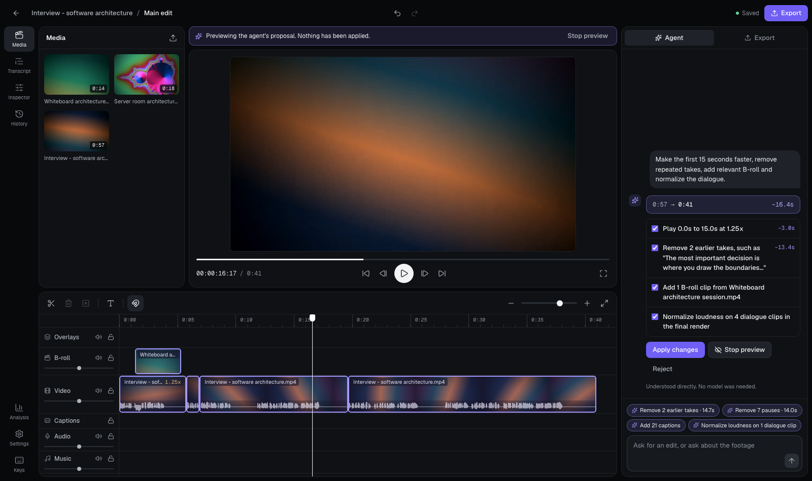

# Agent Edit

An AI-native video editor. Drop in raw footage, describe the edit in plain words, and review the agent's proposal as real, reversible operations on a multi-track timeline. Nothing changes until you apply it, and every edit can be undone.



It runs entirely on your own machine with free, local models: whisper.cpp for speech and Ollama for planning. Claude and Deepgram adapters are included as paid options.

## What it does

- **Edits from a sentence.** "Make the first 15 seconds faster, remove repeated takes, add relevant B-roll and normalize the dialogue" becomes a list of steps you can tick on or off, preview on the timeline and apply as one undoable edit. A clear instruction is understood directly, in a fraction of a second, without a model.
- **Knows the footage.** Transcripts, pauses, repeated takes, scenes, chapters and highlights are measured once and used for every request, so a cut lands on real word boundaries rather than a model's guess.
- **Asks before it acts.** The agent writes proposals only. Edits that remove footage must trace back to words you used, and a plan that would remove most of the edit unasked carries a warning.
- **Suggests what the footage needs.** Chips like "Remove 7 pauses · 14.0s" are measured against the current edit, and disappear once done.
- **Is a real editor too.** Multi-track timeline with filmstrips and waveforms, trimming, splitting, ripple delete, captions, a transcript you can click through and cut from, version history, and keyboard shortcuts (`?` lists them).
- **Exports for real.** FFmpeg renders from the original files in the background, including vertical Shorts framed on where the movement is.

See [docs/ARCHITECTURE.md](docs/ARCHITECTURE.md) for the design, and [its limitations section](docs/ARCHITECTURE.md#9-known-limitations) for what it does not do. It has been tested on generated footage and synthetic speech only, so expect rough edges on real camera recordings, and please report them.

## Run it

Requires Node 22.12+, Docker (Docker Desktop, Colima or Docker Engine) and FFmpeg 6 or newer with libass, which captions need. Most Linux packages include it. On macOS, run `brew install ffmpeg-full`, then set `FFMPEG_PATH` and `FFPROBE_PATH` from `.env.example`.

```sh
npm install
cp .env.example .env
npm run infra:up      # MongoDB on 27017, Redis on 6380, S3 storage on 8333
npm run dev           # web on :5173, API on :4000, plus the worker
```

Open http://localhost:5173, create an account and drop a video on the dashboard. That makes a project shaped like the file and opens the editor with the footage on the timeline. Press `?` there for the keyboard shortcuts. `GET /health/ready` reports MongoDB, Redis, storage and live worker count.

## AI providers

Each capability is chosen in `.env`, and each can be off. A clear instruction needs no model at all and is planned instantly. Without a language model, anything else falls back to labelled rule-based planning.

| Variable          | Free and local                                                      | Paid                                  |
| ----------------- | ------------------------------------------------------------------- | ------------------------------------- |
| `SPEECH_PROVIDER` | `whisper` (run `brew install whisper-cpp`, `npm run setup:whisper`) | `deepgram` (also identifies speakers) |
| `LLM_PROVIDER`    | `ollama` (`OLLAMA_MODEL`)                                           | `anthropic` (`ANTHROPIC_API_KEY`)     |
| `VISION_PROVIDER` | `ollama` (`OLLAMA_VISION_MODEL`)                                    | `anthropic`                           |

## Check it

| Command              | What it does                                                                                                                                                          |
| -------------------- | --------------------------------------------------------------------------------------------------------------------------------------------------------------------- |
| `npm run typecheck`  | Strict TypeScript across every package, app and test                                                                                                                  |
| `npm test`           | Unit and integration tests against the real MongoDB, Redis, storage and FFmpeg, using throwaway databases, buckets and key prefixes. Requires `infra:up`.             |
| `npm run test:demo`  | The acceptance test: the full demonstration in a browser with real speech, Whisper and a language model, then transcribes the export. Requires `npm run dev`.         |
| `npm run test:e2e`   | Every other browser suite. Requires `npm run dev` and, on first use, `npx playwright install chromium`.                                                               |
| `npm run eval:agent` | Scores the planner on 21 instructions against a real model. Not part of `npm test`, because it needs a model and takes minutes. Set `OLLAMA_MODEL` to compare models. |
| `npm run test:long`  | A 3-hour, multi-GB file: interrupted upload, worker killed mid-encode, a 500-clip export and a full-length export, with memory measured. Takes an hour or more.       |

The browser suites accept `E2E_BASE_URL`, so they can run against a production build too.

## Deploy it

`npm run build` builds everything. With `WEB_DIST` set to the absolute path of `apps/web/dist`, and `WEB_ORIGIN` set to the address people use, the API also serves the web app under a strict content security policy, so `npm start -w @agent-edit/api` and `npm start -w @agent-edit/worker` are a complete deployment behind TLS.

[compose.production.yml](compose.production.yml) runs the same thing in containers: one image per process, non-root, on read-only filesystems, with bounded resources for the worker. Its header lists what to configure. Replace every development credential first.

Local `.env` choices do not carry over: the images have no whisper.cpp, so use `SPEECH_PROVIDER=deepgram` or add it to the worker image.

## Contributing

Issues and pull requests are welcome. Run `npm run typecheck`, `npm test` and `npx prettier --check .` before opening a pull request; CI runs the same. For a change to the editor or agent, run the browser suite that covers it too, because they catch what unit tests miss.

## Layout

```
apps/web                  React editor (Vite, CSS Modules, Zustand, React Query)
apps/api                  Fastify API and WebSocket gateway. Never runs heavy work.
apps/worker               BullMQ consumers. The only place FFmpeg and models run.
packages/shared           Time math, IDs, formats, step graph, error codes
packages/validation       Zod schemas shared by API, web and timeline operations
packages/timeline-engine  The pure operation reducer shared by browser and server
packages/media-engine     FFmpeg: probing, proxies, analysis and the render compiler
packages/ai-engine        Provider adapters, planners and the plan compiler
packages/infra            MongoDB documents, S3 storage, queues and events
```

## License

[MIT](LICENSE)
